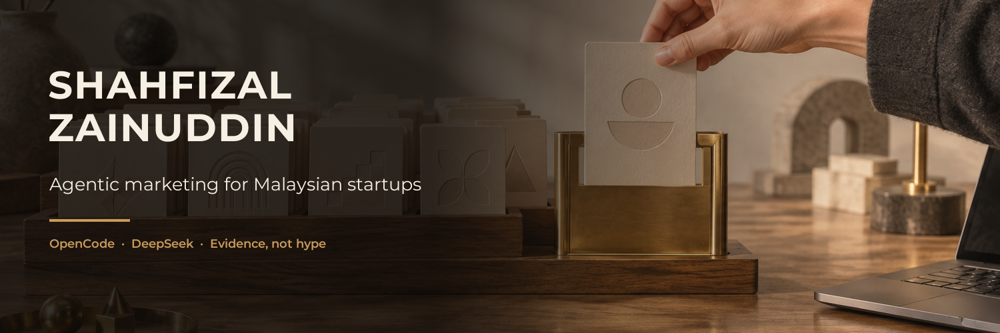

  

<h1 align="center">Shahfizal Zainuddin</h1>

  <strong>Agentic marketing for Malaysian startups.</strong> 
  <strong>S.A.M Studio · Malaysia</strong> 
  Creator of <em>The Agentic Marketer</em> and the S.A.M Agent Skills pack. 
  I teach teams to run AI agents with evidence, not hype.

  <a href="https://www.linkedin.com/in/shahfizalzainuddin/">LinkedIn</a> ·
  <a href="https://github.com/shahfizal/sam-agent-skills-starter">Free skill pack</a> ·
  <a href="https://github.com/shahfizal?tab=repositories">Repositories</a>

---

<table>
<tr>
<td width="220" valign="top">
  
</td>
<td valign="top">

### What I do

I help Malaysian startups turn AI from a demo into an operating system: a working folder, a rulebook, a model, and a phone that can approve the work.

- **Agentic marketing systems** — content engines, research, scheduling, reporting and human approval gates.
- **OpenCode + DeepSeek** — supervised agents that run in the terminal, on a VPS, or from a phone.
- **Teaching and coaching** — a 30-day module, labs and a skill pack students can install in one prompt.

</td>
</tr>
</table>

## What I'm building

| Project | What it is |
|---|---|
| **The Agentic Marketer** | A bilingual field guide to OpenCode, DeepSeek and a marketing assistant that works from your phone. |
| **S.A.M Agent Skills** | 17 reusable skills for marketing, writing, research and creative production. A free starter pack and a private cohort pack. |
| **Agentic AI coaching** | Practical workshops for startups that want taste, not tool worship. |

## How I work

- **Evidence over claims.** A render, a post or a file is not done until it exists and passes a check.
- **Approval before action.** Publishing, spending and deleting are separate decisions.
- **Human voice.** Specific detail beats polished generic copy.
- **Affordable stacks.** Small models, free tiers and a VPS when the workflow earns it.

## Selected work

- [S.A.M Agent Skills — free starter](https://github.com/shahfizal/sam-agent-skills-starter) — four skills for writing, strategy, social and QA.
- [S.A.M Agent Skills — cohort](https://github.com/shahfizal/sam-agent-skills) — the full 17-skill pack (private; enrolled students).
- [The Agentic Marketer](https://github.com/shahfizal?tab=repositories) — the book and teaching materials.

## Background

A background across marketing, design, media production and operations — now focused on agentic AI for small businesses. Based in Malaysia. I write and teach in English and Bahasa Melayu.

## Connect

[LinkedIn](https://www.linkedin.com/in/shahfizalzainuddin/) · [GitHub](https://github.com/shahfizal)

Building in public, with evidence.
